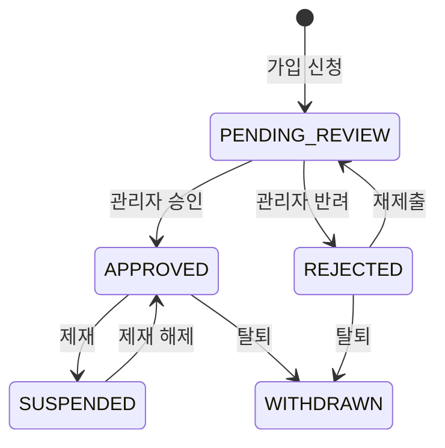
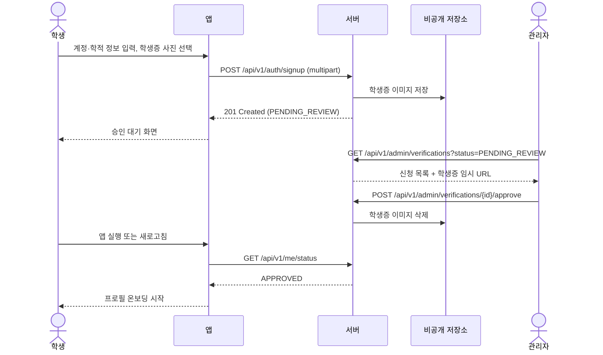
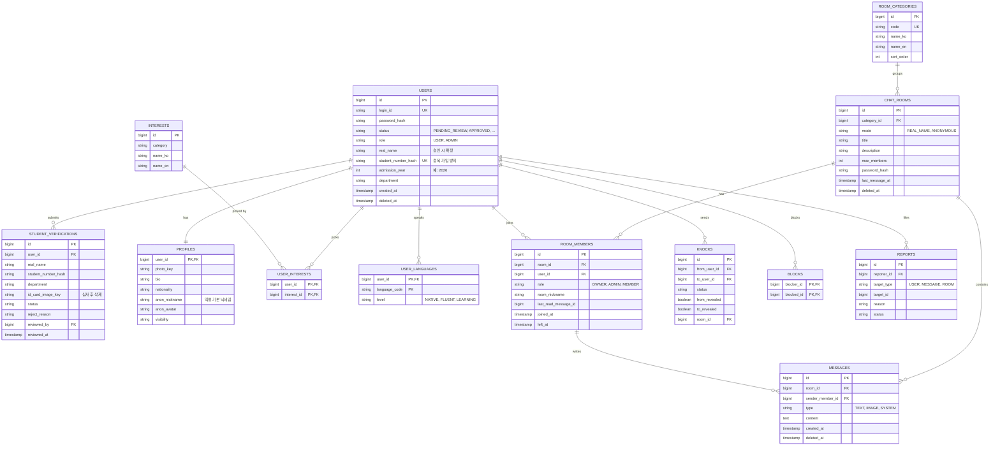

# 아키텍처 (초안)

> Phase 0 기준 초안입니다. 각 Phase를 진행하면서 실제 구현에 맞게 고쳐 나갑니다.

## 1. 시스템 구성

```
[Android 앱] ──REST(HTTPS)──┐
             ──WebSocket────┤
                            ▼
                     [Nginx (운영)]
                            ▼
              [Spring Boot 서버 (Kotlin)]
               │        │          │
        PostgreSQL    Redis    Object Storage
        (주 데이터)  (채팅 Pub/Sub,  (이미지, 학생증)
                      캐시)

외부 API: FCM 푸시(Phase 6), 번역 API(Phase 6)
```

- 서버는 JWT를 써서 상태를 들고 있지 않습니다(stateless). 사용자가 늘면 서버를 여러 대로 늘릴 수 있고, 채팅 메시지는 Redis Pub/Sub로 서버끼리 전달합니다.
- 운영 환경은 Oracle Cloud Always Free VM 1대에서 Docker Compose로 띄웁니다.

## 2. 패키지 구조

### 서버 (`server/`)
```
com.caubuddy.server
├── common/        # 응답 포맷, 예외 처리, 공통 설정       (Phase 0)
├── auth/          # 로그인, JWT 발급·재발급               (Phase 1)
├── user/          # 계정, 계정 상태                       (Phase 1)
├── verification/  # 학생증 제출·심사                      (Phase 1)
├── admin/         # 관리자 전용 API                       (Phase 1~)
├── storage/       # 파일 저장소 추상화 (로컬/Object Storage) (Phase 1)
├── profile/       # 프로필, 관심사, 언어                  (Phase 2)
├── room/          # 채팅방                                (Phase 3)
├── chat/          # 메시지, WebSocket                     (Phase 4)
├── match/         # 친구 추천, 노크                       (Phase 5)
└── report/        # 신고, 차단, 제재                      (Phase 6)
```

### 앱 (`android/`)
```
com.caubuddy.android
├── designsystem/  # 테마(색·글꼴·간격), 공통 컴포넌트   (Phase 0~)
├── navigation/    # 하단 탭, 라우트                     (Phase 0~)
├── feature/
│   ├── home/      # 채팅방 둘러보기
│   ├── chat/      # 내 채팅 목록, 채팅방
│   ├── friends/   # 추천 친구, 노크
│   └── my/        # 마이페이지, 프로필 수정
└── core/          # network, data, datastore           (Phase 1~)
```

## 3. 가입과 계정 상태

### 계정 상태


- `PENDING_REVIEW`, `REJECTED` 상태에서도 로그인은 됩니다. 다만 쓸 수 있는 API는 내 상태 조회, 재제출, 탈퇴뿐입니다.
- 채팅, 프로필 등 나머지 기능은 `APPROVED` 상태여야 쓸 수 있습니다.

### 가입 흐름


## 4. 익명 / 실명 설계

| 구분 | 실명 | 익명 |
|---|---|---|
| 어디서 | 실명방, 친구 목록, 노크 실명 공개 후 | 익명방, 노크(공개 전) |
| 보이는 정보 | 이름, 학과, 학번 연도, 국적, 사진, 관심사 | 방별 닉네임, 기본 아바타 |
| 정보 출처 | 이름·학과·학번 연도는 학생증 심사로 검증된 값 (사용자가 직접 수정 불가) | 사용자가 자유롭게 정함 |

규칙
1. 방의 모드(실명/익명)는 만들 때 정하고 이후 바꿀 수 없습니다.
2. 익명방 API 응답에는 실제 사용자 ID(`userId`)를 넣지 않고, 방 안에서만 의미 있는 멤버 ID(`memberId`)만 넣습니다. 그래서 응답을 모아도 다른 방이나 실명 프로필과 연결할 수 없습니다.
3. 메시지는 `room_members.id`를 작성자로 저장합니다. 서버 내부에서는 실제 사용자와 연결되어 있어, 신고가 들어오면 관리자가 작성자를 확인하고 제재할 수 있습니다.
4. 노크(1:1 대화)는 익명으로 시작할 수 있고, 양쪽이 모두 동의해야 실명이 공개됩니다.

## 5. ERD 초안



## 6. 개인정보 처리 원칙

- 학생증 이미지는 **비공개 버킷**에 저장하고, 관리자만 짧게 만료되는 임시 URL로 볼 수 있습니다. 심사가 끝나면 삭제합니다.
- 학번 원문은 저장하지 않습니다. 중복 가입을 막는 데 필요한 해시(서버 비밀값을 섞은 HMAC)와 화면 표시용 입학 연도만 보관합니다.
- 비밀번호는 BCrypt로 해시합니다.
- 탈퇴하면 계정을 soft delete로 처리하고, 개인 식별 정보는 지웁니다.
