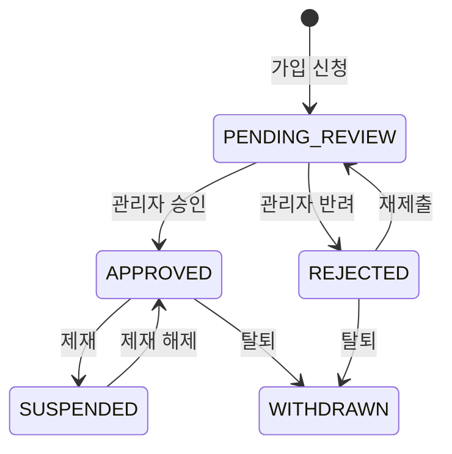
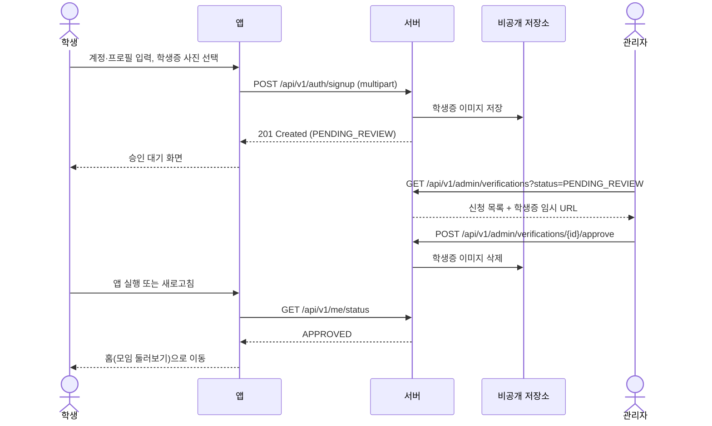

# Campus Hangout 아키텍처 (초안)

> Phase 0 기준 초안입니다. 각 Phase를 진행하면서 실제 구현에 맞게 고쳐 나갑니다.

## 1. 시스템 구성

```
[Android 앱] ──REST(HTTPS)──┐
             ──WebSocket────┤
                            ▼
  ┌──────── Azure VM (B1s) ─────────┐
  │  [Nginx] → [Spring Boot 서버]    │
  │                 │     [Redis]    │   (채팅 Pub/Sub, 캐시)
  └─────────────────┼────────────────┘
                    │
        ┌───────────┴───────────┐
  Azure Database          Azure Blob Storage
  for PostgreSQL          (이미지, 학생증)
  (주 데이터, 관리형)

외부 API: FCM 푸시(Phase 6), 번역 API(Phase 6)
```

- 서버는 JWT를 써서 상태를 들고 있지 않습니다(stateless). 사용자가 늘면 서버를 여러 대로 늘릴 수 있고, 채팅 메시지는 Redis Pub/Sub로 서버끼리 전달합니다.
- 운영 환경은 Azure for Students입니다. VM 1대(B1s, 메모리 1GB)에서 Nginx·서버·Redis를 Docker Compose로 띄우고, DB는 관리형 PostgreSQL, 파일은 Blob Storage를 씁니다.
- 로컬 개발 환경은 `infra/docker-compose.yml`의 PostgreSQL·Redis를 씁니다. 서버 코드는 설정(프로필)만 바꿔서 두 환경에서 똑같이 동작하게 만듭니다.

## 2. 패키지 구조

### 서버 (`server/`)
```
com.campushangout.server
├── common/        # 응답 포맷, 예외 처리, 공통 설정       (Phase 0)
├── auth/          # 로그인, JWT 발급·재발급               (Phase 1)
├── user/          # 계정, 계정 상태                       (Phase 1)
├── verification/  # 학생증 제출·심사                      (Phase 1)
├── admin/         # 관리자 전용 API                       (Phase 1~)
├── storage/       # 파일 저장소 추상화 (로컬 디스크/Azure Blob) (Phase 1)
├── catalog/       # 카테고리·태그·관심사 목록 (DB 데이터)  (Phase 2)
├── profile/       # 프로필, 관심사, 언어                  (Phase 1~2)
├── notification/  # 알림 설정, 푸시                       (Phase 2, 6)
├── room/          # 모임 방, 참여, 참여 요청              (Phase 3)
├── chat/          # 메시지, WebSocket                     (Phase 4)
├── friend/        # 노크, 친구, 추천                      (Phase 5)
└── report/        # 신고, 차단, 제재                      (Phase 6)
```

### 앱 (`android/`)
```
com.campushangout.android
├── designsystem/  # 테마(색·글꼴·간격), 공통 컴포넌트   (Phase 0~)
├── navigation/    # 하단 탭, 라우트                     (Phase 0~)
├── feature/
│   ├── auth/      # 로그인, 가입 4단계, 승인 대기          (Phase 1)
│   ├── admin/     # 학생증 심사 (관리자 전용)              (Phase 1)
│   ├── home/      # 모임 방 둘러보기, 검색                 (Phase 3)
│   ├── room/      # 방 만들기·상세·참여, 방장 관리         (Phase 3)
│   ├── chat/      # 내 채팅 목록, 채팅방                   (Phase 4)
│   ├── friends/   # 추천, 내 친구, 노크                    (Phase 5)
│   └── my/        # 마이 캠퍼스, 프로필 수정, 설정         (Phase 2)
└── core/          # network, data, datastore           (Phase 1~)
```

## 3. 가입과 계정 상태

### 계정 상태


- `PENDING_REVIEW`, `REJECTED` 상태에서도 로그인은 됩니다. 다만 쓸 수 있는 API는 내 상태 조회, 재제출, 탈퇴뿐입니다.
- 채팅, 프로필 등 나머지 기능은 `APPROVED` 상태여야 쓸 수 있습니다.

### 가입 흐름


## 4. 익명 / 실명 설계

| 구분 | 실명 | 익명 |
|---|---|---|
| 어디서 | 실명방, 친구·노크, 마이 캠퍼스 | 익명방 |
| 보이는 정보 | 이름, 전공, 국적, 사용 언어, 아바타, 관심사 | 방별 닉네임, 기본 아바타 |
| 정보 출처 | 이름은 학생증 심사로 확인된 값 (Edit profile에서는 읽기 전용으로 표시) | 참여할 때 직접 정하거나 무작위 생성 |

규칙
1. 방의 모드(실명/익명)는 만들 때 정하고 이후 바꿀 수 없습니다.
2. 익명방 API 응답에는 실제 사용자 ID(`userId`)를 넣지 않고, 방 안에서만 의미 있는 멤버 ID(`memberId`)만 넣습니다. 그래서 응답을 모아도 다른 방이나 실명 프로필과 연결할 수 없습니다.
3. 메시지는 `room_members.id`를 작성자로 저장합니다. 서버 내부에서는 실제 사용자와 연결되어 있어, 신고가 들어오면 관리자가 작성자를 확인하고 제재할 수 있습니다.
4. 노크와 친구는 **실명 기능**입니다(Figma 기준). 익명으로 대화하고 싶으면 익명방을 씁니다.
5. 익명방에 참여 요청을 보낼 때 정한 닉네임은 요청에 함께 저장되고, 수락되면 그대로 방 닉네임이 됩니다.

## 5. ERD 초안 (Figma 반영)

- 선택지(카테고리·태그·관심사·알림 종류·신고 사유)는 테이블 데이터로 둡니다. 운영 중 추가해도 코드를 바꾸지 않습니다.
- 모임 방과 1:1 대화는 같은 `CHAT_ROOMS` 테이블을 `type`으로 구분해서, 채팅 기능을 그대로 재사용합니다.
- 상태값(`status`)은 서버의 enum과 상태 전이 함수 한곳에서만 바꿉니다.

```mermaid
erDiagram
    USERS ||--o{ STUDENT_VERIFICATIONS : submits
    USERS ||--|| PROFILES : has
    USERS ||--o{ USER_LANGUAGES : speaks
    USERS ||--o{ USER_INTERESTS : picks
    CATEGORIES ||--o{ TAGS : groups
    TAGS ||--o{ USER_INTERESTS : "picked as"
    CATEGORIES ||--o{ CHAT_ROOMS : classifies
    CHAT_ROOMS ||--o{ ROOM_TAGS : has
    TAGS ||--o{ ROOM_TAGS : "used in"
    CHAT_ROOMS ||--o{ ROOM_MEMBERS : has
    USERS ||--o{ ROOM_MEMBERS : joins
    CHAT_ROOMS ||--o{ ROOM_JOIN_REQUESTS : receives
    USERS ||--o{ ROOM_JOIN_REQUESTS : sends
    CHAT_ROOMS ||--o{ MESSAGES : contains
    ROOM_MEMBERS ||--o{ MESSAGES : writes
    USERS ||--o{ KNOCKS : sends
    USERS ||--o{ FRIENDSHIPS : has
    USERS ||--o{ NOTIFICATION_SETTINGS : sets
    USERS ||--o{ BLOCKS : blocks
    USERS ||--o{ REPORTS : files

    USERS {
        bigint id PK
        string email UK "로그인 아이디"
        string password_hash
        string status "PENDING_REVIEW, APPROVED, ..."
        string role "USER, ADMIN"
        string real_name "승인 시 확정"
        string student_number_hash UK "중복 가입 방지"
        int admission_year
        timestamp created_at
        timestamp deleted_at
    }
    STUDENT_VERIFICATIONS {
        bigint id PK
        bigint user_id FK
        string id_card_image_key "심사 후 삭제"
        string status "SUBMITTED, APPROVED, REJECTED"
        string reject_reason
        bigint reviewed_by FK
        timestamp reviewed_at
    }
    PROFILES {
        bigint user_id PK, FK
        string nationality
        string major
        string status_message
        string avatar_color
        string photo_key
        string sticker_board "선택 기능, JSON"
        string visibility
    }
    USER_LANGUAGES {
        bigint user_id PK, FK
        string language_code PK
        string level "NATIVE, FLUENT, LEARNING"
    }
    CATEGORIES {
        bigint id PK
        string code UK "FOOD_CAFE, STUDY_LANGUAGE, ..."
        string name_ko
        string name_en
        int sort_order
        boolean active
    }
    TAGS {
        bigint id PK
        bigint category_id FK
        string code UK
        string name_ko
        string name_en
        boolean active
    }
    USER_INTERESTS {
        bigint user_id PK, FK
        bigint tag_id PK, FK
    }
    CHAT_ROOMS {
        bigint id PK
        string type "GROUP, DIRECT"
        bigint category_id FK "모임만"
        string mode "REAL_NAME, ANONYMOUS"
        string join_policy "OPEN, APPROVAL"
        string title
        string description
        timestamp starts_at
        string location_text
        int max_members
        string status "OPEN, FULL, ENDED, DELETED"
        timestamp last_message_at
        timestamp created_at
    }
    ROOM_TAGS {
        bigint room_id PK, FK
        bigint tag_id PK, FK
    }
    ROOM_MEMBERS {
        bigint id PK
        bigint room_id FK
        bigint user_id FK
        string role "HOST, MEMBER"
        string room_nickname "익명방만"
        boolean muted
        bigint last_read_message_id
        timestamp joined_at
        timestamp left_at
    }
    ROOM_JOIN_REQUESTS {
        bigint id PK
        bigint room_id FK
        bigint user_id FK
        string nickname "익명방 참여 시"
        string status "PENDING, ACCEPTED, DECLINED, CANCELED"
        timestamp created_at
        timestamp decided_at
    }
    MESSAGES {
        bigint id PK
        bigint room_id FK
        bigint sender_member_id FK
        string type "TEXT, IMAGE, LOCATION, SYSTEM"
        text content
        timestamp created_at
        timestamp deleted_at
    }
    KNOCKS {
        bigint id PK
        bigint from_user_id FK
        bigint to_user_id FK
        string message
        string status "PENDING, ACCEPTED, DECLINED, CANCELED"
        bigint direct_room_id FK "수락 후 1:1 방"
        timestamp created_at
        timestamp decided_at
    }
    FRIENDSHIPS {
        bigint user_low_id PK, FK "두 ID 중 작은 값"
        bigint user_high_id PK, FK
        timestamp created_at
    }
    NOTIFICATION_SETTINGS {
        bigint user_id PK, FK
        string type PK "CHAT, KNOCK, MEETUP, ..."
        boolean enabled
    }
    BLOCKS {
        bigint blocker_id PK, FK
        bigint blocked_id PK, FK
    }
    REPORTS {
        bigint id PK
        bigint reporter_id FK
        string target_type "ROOM, MESSAGE, KNOCK, USER"
        bigint target_id
        string reason_code
        string status
    }
```



## 6. 개인정보 처리 원칙

- 학생증 이미지는 **비공개 Blob 컨테이너**에 저장하고, 관리자만 짧게 만료되는 임시 URL(SAS)로 볼 수 있습니다. 심사가 끝나면 삭제합니다.
- 학번 원문은 저장하지 않습니다. 중복 가입을 막는 데 필요한 해시(서버 비밀값을 섞은 HMAC)와 화면 표시용 입학 연도만 보관합니다.
- 비밀번호는 BCrypt로 해시합니다.
- 탈퇴하면 계정을 soft delete로 처리하고, 개인 식별 정보는 지웁니다.
